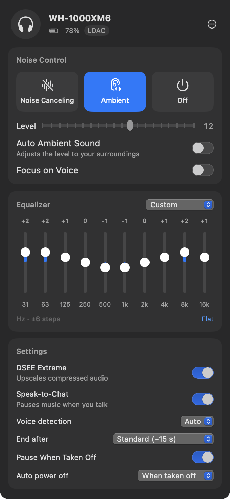
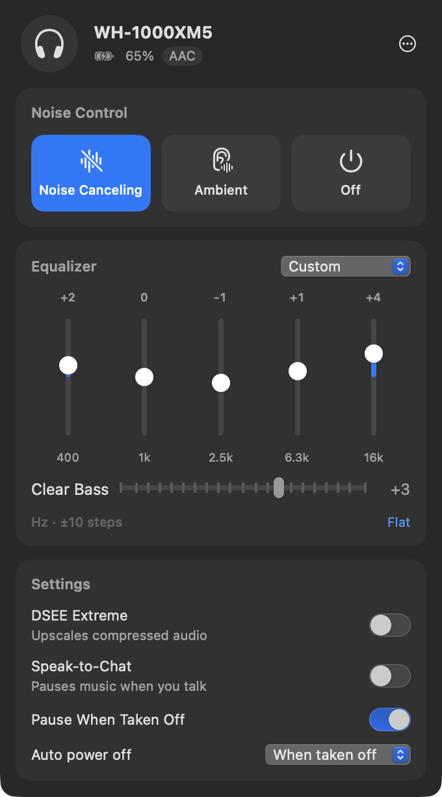

# XMBridge

[](https://github.com/AndyWW214434/XMBridge/actions/workflows/ci.yml)
[](https://github.com/AndyWW214434/XMBridge/releases/latest)

[](LICENSE)

**Control your Sony WH-1000XM6 (and WH-1000XM5) from your Mac's menu bar:** noise cancelling, ambient sound,
equalizer, DSEE Extreme, Speak-to-Chat and more, without reaching for your phone.

<p>

&nbsp;

</p>

## What it does

Sony only lets you change the headphones' settings from **Sound Connect**, a phone app. On a Mac the headphones
play audio, but switching to ambient sound or adjusting the EQ means picking up your phone.

XMBridge is a small native Mac app that sits in the menu bar and talks to the headphones directly over Bluetooth,
on the same control channel Sound Connect uses. Click the headphones icon to:

| | WH-1000XM6 | WH-1000XM5 |
|---|---|---|
| Switch Noise Canceling / Ambient / Off | ✅ | ✅ |
| Ambient level (1–20) and Focus on Voice | ✅ | ✅ |
| Auto Ambient Sound, with sensitivity | ✅ | — |
| Equalizer presets and user presets | ✅ | ✅ |
| Custom equalizer | 10 bands, ±6 | 5 bands + Clear Bass, ±10 |
| DSEE Extreme | ✅ | ✅ |
| Speak-to-Chat, with sensitivity and timeout | ✅ | ✅ |
| Pause when taken off, auto power off | ✅ | ✅ |
| Battery level in the menu bar, codec in use | ✅ | ✅ |
| Turn the headphones off | ✅ | ✅ |

- **Stays in sync**: press the noise-cancelling button on the headphones and the app follows.
- **Connects by itself** whenever the headphones connect to your Mac. It can also open at login.
- **Only shows what your headphones support**: it asks the headphones for their feature list and builds the
  controls from that.
- **Changes the headphones themselves**, like Sound Connect does, so settings stay put when you switch devices.

## Get it

**→ Step-by-step guide: [docs/TUTORIAL.md](docs/TUTORIAL.md)**

- **Download:** grab `XMBridge.zip` from the [latest release](https://github.com/AndyWW214434/XMBridge/releases/latest),
  unzip, and move it to Applications. The app isn't notarized by Apple, so the first launch needs
  **System Settings → Privacy & Security → Open Anyway** (details in the tutorial).
- **Build it yourself** with just the Xcode Command Line Tools (`xcode-select --install`):

  ```bash
  git clone https://github.com/AndyWW214434/XMBridge.git
  cd XMBridge
  scripts/build-app.sh
  open build/XMBridge.app
  ```

Then connect the headphones in **System Settings → Bluetooth**, click the headphones icon in the menu bar, and
pick your headset.

Requires macOS 13 Ventura or later, on Apple Silicon or Intel.

## Status

Tested on a **WH-1000XM6** (firmware 2.1.0): connecting and reading every setting works. Changing settings, and
the WH-1000XM5, use byte layouts that other projects have verified on those headsets, but they haven't been
reported working with XMBridge yet. If you try it, please
[open an issue](https://github.com/AndyWW214434/XMBridge/issues/new) and say how it went. That's the most useful
contribution right now.

## How it works

The headphones expose a Bluetooth Classic RFCOMM service (UUID `956C7B26-D49A-4BA8-B03F-B17D393CB6E2`) that
speaks Sony's binary "MDR" protocol: framed messages, a 1-bit sequence number, and an ACK for every frame. After a
short handshake, XMBridge asks for the headset's **support functions** and uses them to choose command variants.
That's how one code path handles the XM6 (noise control `0x19` with Auto Ambient, 10-band EQ) and the XM5
(`0x17`, 5 bands + Clear Bass).

**→ Byte-by-byte guide with a recorded XM6 session: [docs/PROTOCOL.md](docs/PROTOCOL.md)**. Start there if you
want to port this to Linux, Windows or Android, or add a feature.

```
Sources/
  MDRKit/                 protocol library, no Bluetooth dependency
    Frame.swift           framing, escaping, checksum, stream reassembly
    Session.swift         sequence numbers, ACKs, retries, request/reply matching
    Protocol.swift        command codes and request builders
    State.swift           headset state and the parser for every reply/notification
  XMBridge/               the menu bar app
    Bluetooth/            IOBluetooth RFCOMM transport, connect notifications
    HeadphoneController   connection lifecycle and settings
    Views/                SwiftUI
Tests/MDRKitTests/        unit tests, including a recorded WH-1000XM6 session
```

## Development

```bash
swift test                                    # protocol unit tests
CONFIG=debug scripts/build-app.sh             # debug build: logs every frame (Console.app, filter "[mdr]")
open -n build/XMBridge.app --args --demo xm6  # UI with sample data, no headphones needed (xm5, xm6, disconnected)
UNIVERSAL=1 scripts/build-app.sh              # Apple Silicon + Intel build and build/XMBridge.zip
```

Launch the app with `open` rather than running the binary directly: macOS checks Bluetooth permission against the
app that launched the process.

## Credits

The protocol was reverse-engineered by others. This project stands on:

- [mos9527/SonyHeadphonesClient](https://github.com/mos9527/SonyHeadphonesClient) (libmdr): the most complete
  map of Sony's v2 protocol, including the XM6's noise-adaptation and 10-band EQ layouts
- [Gadgetbridge](https://codeberg.org/Freeyourgadget/Gadgetbridge): Sony headphone support for Android
- [AmitRajput-Dev/SonyBridge](https://github.com/AmitRajput-Dev/SonyBridge) and
  [Plutoberth/SonyHeadphonesClient](https://github.com/Plutoberth/SonyHeadphonesClient): the desktop clients
  that inspired this app

## Disclaimer

Not affiliated with, endorsed by, or connected to Sony. "WH-1000XM5" and "WH-1000XM6" are used only to describe
compatibility. The app uses a reverse-engineered protocol for interoperability; use it at your own risk.

## License

[MIT](LICENSE)
