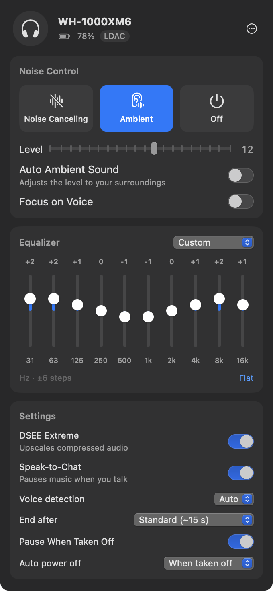

# XMBridge tutorial: control your WH-1000XM6 from your Mac

Sony's **Sound Connect** app, where you switch noise cancelling, tune the equalizer and change the headphones'
settings, only exists for phones. When your WH-1000XM6 is connected to a Mac you can listen, but you can't change
anything without picking up your phone.

**XMBridge** fixes that. It's a small app that lives in your Mac's menu bar and talks to the headphones directly
over Bluetooth, using the same control channel Sound Connect uses. Click the headphones icon and you get:

- **Noise Canceling / Ambient Sound / Off**, the ambient level (1–20), Focus on Voice, and the XM6's
  **Auto Ambient Sound**
- The **equalizer**: Sony's presets, your saved user presets, and a custom 10-band EQ (5 bands plus Clear Bass on
  the XM5)
- **DSEE Extreme**, **Speak-to-Chat**, **Pause when taken off**, and **Auto power off**
- **Battery level** in the menu bar, plus the Bluetooth codec in use
- A button to **turn the headphones off**

Settings are written to the headphones themselves, just like Sound Connect does. If you press the noise-cancelling
button on the headphones, the app updates right away.

It also works with the **WH-1000XM5**. This guide says "XM6" throughout, but the steps are the same for both.

> XMBridge is an independent open-source project. It isn't made by or affiliated with Sony.

---

## 1. What you need

- A Mac running **macOS 13 Ventura or later** (Apple Silicon or Intel)
- A **WH-1000XM6** or **WH-1000XM5**
- About 5 minutes

## 2. Get the app

Pick one of these two options.

### Option A: download it (easiest)

1. Open the [latest release](https://github.com/AndyWW214434/XMBridge/releases/latest) and download
   **XMBridge.zip**.
2. Double-click the zip to unzip it, then drag **XMBridge** into your **Applications** folder.
3. Open it once. Because XMBridge isn't distributed through the App Store and isn't notarized by Apple (that needs
   a paid developer account), macOS will block the first launch with a message like *"Apple could not verify
   XMBridge is free of malware"*. To allow it:
   - Open **System Settings → Privacy & Security**, scroll down to the message about XMBridge, and click
     **Open Anyway**. Confirm with your password or Touch ID.
   - Or, in Terminal, run this once and then open the app normally:

     ```bash
     xattr -dr com.apple.quarantine /Applications/XMBridge.app
     ```

You only have to do this once. If you'd rather not trust a downloaded app, use option B: you build it yourself
from the source code you can read.

### Option B: build it yourself

1. Install Apple's Command Line Tools (skip this if you already have Xcode). In Terminal:

   ```bash
   xcode-select --install
   ```

2. Download the source and build:

   ```bash
   git clone https://github.com/AndyWW214434/XMBridge.git
   cd XMBridge
   scripts/build-app.sh
   ```

   The first build takes a minute or two. When it prints `Built build/XMBridge.app`, it's done.

3. Move the app to Applications and open it:

   ```bash
   mv build/XMBridge.app /Applications/
   open /Applications/XMBridge.app
   ```

An app you built on your own Mac isn't blocked by Gatekeeper.

## 3. Connect the headphones to your Mac

XMBridge works on top of a normal Bluetooth connection, so connect the headphones the usual way first.

1. Put the headphones in pairing mode. New headphones start in pairing mode the first time they're turned on;
   otherwise Sony's [WH-1000XM6 help guide](https://helpguide.sony.net/mdr/2984/v1/en/index.html) shows how.
   You'll hear "Bluetooth pairing".
2. On the Mac, open **System Settings → Bluetooth**, find **WH-1000XM6** and click **Connect**.

If they're already paired, just turn them on. Once they show as **Connected** in Bluetooth settings, you're ready.

## 4. First launch

1. Open **XMBridge**. Nothing appears in the Dock. Look for a **headphones icon** in the menu bar at the top right
   of the screen.
2. The first time, macOS asks whether XMBridge may use **Bluetooth**. Click **Allow**. The app can't reach the
   headphones without it.
3. Click the headphones icon. You'll see **Paired Headphones** with your WH-1000XM6 and a green dot when it's
   connected. Click **Connect**.

After a second or two the full control panel appears, and the menu bar icon shows the battery level.

With **Connect automatically** turned on (the default), XMBridge connects by itself from now on: when it starts,
and whenever the headphones connect to the Mac.

> **Tip:** to start XMBridge when you log in, open the **⋯** menu in the panel and turn on **Open at Login**.

## 5. Using the controls



### Header

The headphone model, the battery level (a bolt means charging), and the Bluetooth codec the Mac is using
(usually AAC, since macOS doesn't support LDAC). The **⋯** button opens a menu with the firmware version,
**Disconnect**, **Turn Off Headphones**, **Connect Automatically**, **Open at Login** and **Quit XMBridge**.

### Noise Control

- **Noise Canceling**: blocks out the world.
- **Ambient**: lets outside sound in. Below it:
  - **Level**: how much outside sound comes through (1–20).
  - **Auto Ambient Sound** (XM6 only): the headphones adjust the ambient level to your surroundings. When it's on,
    choose its **Sensitivity** (Standard, High or Low). The manual level slider is hidden while it's on.
  - **Focus on Voice**: lets voices through and filters other ambient noise.
- **Off**: neither noise cancelling nor ambient sound.

These match the noise-cancelling button on the headphones. Press the button and the app follows.

### Equalizer

- The menu at the top right picks a **preset**: Off, Heavy, Clear, Hard, Soft, Gaming, Custom, or your
  **User Setting** slots. (The XM5 has its own list: Bright, Excited, Mellow, and so on.)
- Drag the **sliders** to shape the sound. The XM6 has **10 bands** from 31 Hz to 16 kHz, each from −6 to +6. The
  XM5 has 5 bands plus a **Clear Bass** slider, from −10 to +10.
- Moving a slider while a built-in preset is selected switches you to **Custom**, starting from that preset's
  curve, like Sound Connect does. Editing a User Setting slot changes that slot.
- **Flat** sets every band to 0.

If the equalizer is greyed out, the headphones have it disabled in their current mode. That's a headphones rule,
not an app one.

### Settings

- **DSEE Extreme**: restores detail that compression removed from music files and streams.
- **Speak-to-Chat**: start talking and the music pauses and ambient sound turns on. When it's on you can set
  **Voice detection** (Auto, High, Low) and **End after** (how long after you stop talking it switches back).
- **Pause When Taken Off**: pauses playback when you take the headphones off.
- **Auto power off**: turn the headphones off when you take them off, after a set time (5 minutes to 3 hours),
  or never.

## 6. Troubleshooting

**I can't find the headphones icon in the menu bar.**
On MacBooks with a notch, menu bar icons that don't fit are hidden behind it. Quit a few other menu bar apps, or
use a menu bar manager such as Ice or Bartender. Check that XMBridge is actually running in Activity Monitor.

**"No Sony WH-1000XM5/XM6 headphones are paired with this Mac."**
The headphones have to be paired with *this Mac* in System Settings → Bluetooth, not only with your phone. Pair
them (step 3), then click the refresh arrow in the panel.

**"Couldn't open the control channel" or "The headphones didn't respond."**
- Make sure the headphones are on and show as **Connected** in Bluetooth settings.
- If they're connected to both your phone and your Mac (multipoint), try disconnecting the phone and connecting
  again.
- Turn the headphones off and on, then click **Connect** again.

**"The headphones disconnected."**
The headphones turned off, went out of range, or switched to another device. With **Connect automatically** on,
XMBridge reconnects by itself when they come back.

**It never asked for Bluetooth, or I clicked Don't Allow.**
Open **System Settings → Privacy & Security → Bluetooth** and turn on **XMBridge**, then quit and reopen the app.

**macOS says the app is damaged or can't be opened.**
That's Gatekeeper blocking a downloaded app. Follow step 2, option A.

**A setting doesn't change, or changes back.**
Please [open an issue](https://github.com/AndyWW214434/XMBridge/issues/new) with your headphone model, firmware
version (in the **⋯** menu) and what happened. A debug log helps a lot: build with
`CONFIG=debug scripts/build-app.sh`, reproduce the problem, then copy the `[mdr]` lines from **Console.app**
(search for `mdr`). They list every message exchanged with the headphones.

## 7. Uninstall

1. Turn off **Open at Login** in the **⋯** menu, then choose **Quit XMBridge**.
2. Drag **XMBridge** from Applications to the Trash.
3. Optionally, remove its saved preferences:

   ```bash
   defaults delete io.github.andyww214434.XMBridge
   ```

Your headphone settings stay as they are; they live on the headphones.

## 8. Going further

Want to know how it works, port it to Linux, Windows or Android, or add support for another Sony model? The
[protocol guide](PROTOCOL.md) explains the Bluetooth messages byte by byte, with a real conversation recorded from a
WH-1000XM6.
